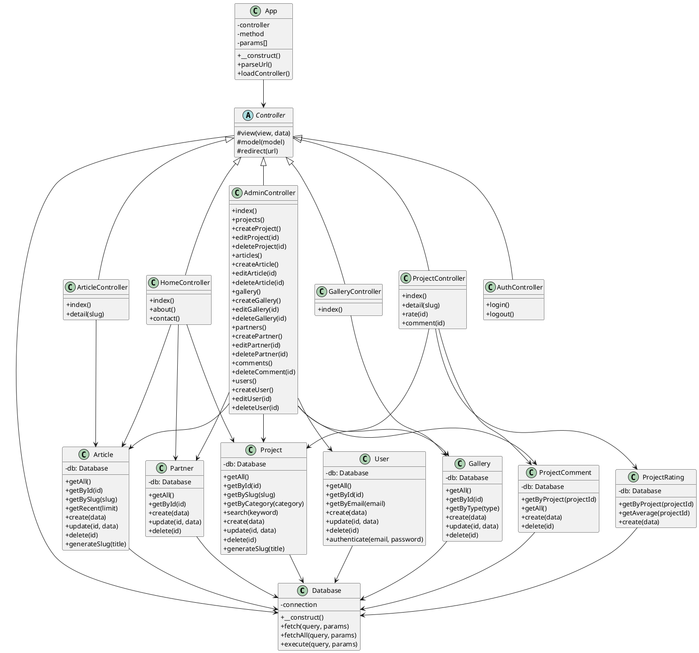

# Class Diagram - Lab MMT

## Deskripsi Class

### Core Classes
- **App**: Main application router
- **Controller**: Base controller (abstract)
- **Database**: Database connection handler

### Controllers
- **HomeController**: Homepage, about, contact
- **ProjectController**: Project listing, detail, rating, comment
- **ArticleController**: Article listing and detail
- **GalleryController**: Gallery display
- **AuthController**: Login/logout
- **AdminController**: Admin panel CRUD operations

### Models
- **Project**: Project management (with team_name, team_members)
- **Article**: Article/news management
- **Gallery**: Media gallery (image/video)
- **Partner**: Partner/collaboration management
- **ProjectComment**: Project comments
- **ProjectRating**: Project ratings (1-5)
- **User**: User management (admin/editor roles)

