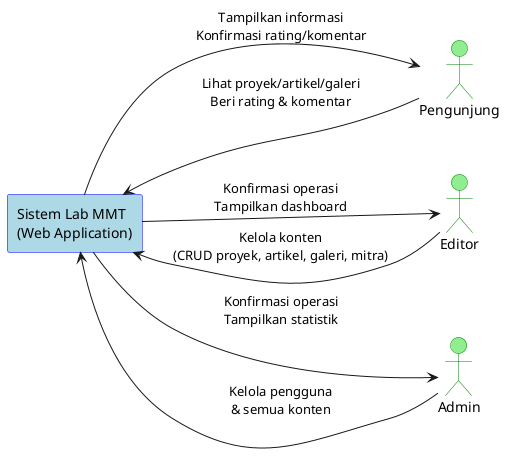
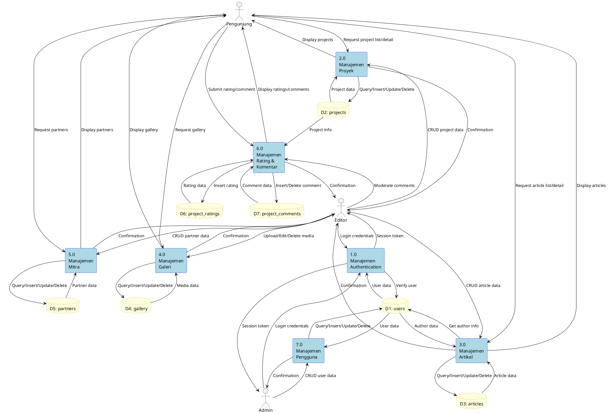
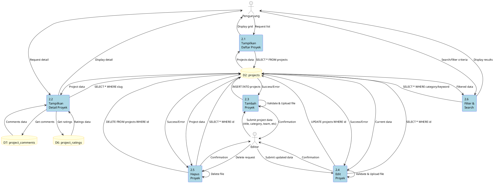

# Data Flow Diagram (DFD) - Lab MMT

## Level 0 - Context Diagram



---

## Level 1 - DFD Overview



---

## Level 2 - DFD Detail (Manajemen Proyek)



---

## Database Flow Summary

### 1. Authentication Flow
```
User (Login) → AuthController → User Model → Database (users)
                     ↓
            Create Session → Store in $_SESSION
                     ↓
            Redirect to Dashboard
```

### 2. Public View Flow
```
Visitor → Controller → Model → Database → Model → Controller → View → Visitor
```

**Example - View Projects:**
```
Visitor → ProjectController::index()
       → Project::getAll()
       → SELECT * FROM projects
       → Return array
       → Render view
       → Display HTML
```

### 3. CRUD Flow (Admin/Editor)
```
Editor → AdminController → Model → Database
              ↓                      ↓
        Upload File             INSERT/UPDATE/DELETE
              ↓                      ↓
        Save to disk            Return status
              ↓                      ↓
        Return success ←────────────┘
```

### 4. Rating & Comment Flow
```
Visitor → Submit Rating/Comment
       → ProjectController::rate() / comment()
       → ProjectRating/ProjectComment Model
       → INSERT INTO project_ratings/comments
       → Return success
       → Reload page with updated data
```

---

## Data Flow Narrative

### A. User Authentication
1. User mengakses halaman login
2. User memasukkan email dan password
3. AuthController menerima input
4. User model memverifikasi credentials dari database
5. Jika valid, create session dan redirect ke dashboard
6. Jika invalid, tampilkan error message

### B. View Projects (Public)
1. Pengunjung mengakses /project
2. ProjectController::index() dipanggil
3. Project model query database: `SELECT * FROM projects ORDER BY created_at DESC`
4. Database return array of projects
5. Controller pass data ke view
6. View render HTML dengan project cards
7. Browser menampilkan ke pengunjung

### C. Create Project (Admin/Editor)
1. Editor login dan akses admin panel
2. Klik "Tambah Proyek Baru"
3. AdminController::createProject() tampilkan form
4. Editor isi form (title, category, team_name, team_members, thumbnail, dll)
5. Submit form ke AdminController::createProject()
6. Controller validasi input
7. Upload thumbnail ke /uploads/projects/
8. Project model insert ke database:
   ```sql
   INSERT INTO projects (title, slug, description, category, tags, 
                         thumbnail, team_name, team_members) 
   VALUES (...)
   ```
9. Database return success
10. Controller redirect ke project list dengan success message

### D. View Project Detail with Rating & Comments
1. Pengunjung klik project card
2. Request ke ProjectController::detail($slug)
3. Controller call beberapa models:
   - Project::getBySlug($slug) → Get project data
   - ProjectRating::getAverage($id) → Get average rating
   - ProjectComment::getByProject($id) → Get all comments
4. Database return semua data
5. Controller pass ke view
6. View render detail page dengan:
   - Project info (title, description, team)
   - Average rating (bintang)
   - Comment list
   - Rating form
   - Comment form
7. Display ke pengunjung

### E. Submit Rating
1. Pengunjung klik rating (1-5 bintang)
2. AJAX/Form submit ke ProjectController::rate($id)
3. Controller validate:
   - Rating antara 1-5
   - Cek IP address (prevent duplicate)
4. ProjectRating model insert:
   ```sql
   INSERT INTO project_ratings (project_id, rating, ip_address)
   VALUES ($id, $rating, $ip)
   ```
5. Database return success
6. Controller reload page atau return JSON
7. Updated rating ditampilkan

### F. Submit Comment
1. Pengunjung isi form comment (name, email, comment)
2. Submit ke ProjectController::comment($id)
3. Controller validate:
   - Required fields tidak kosong
   - Email format valid
4. ProjectComment model insert:
   ```sql
   INSERT INTO project_comments (project_id, name, email, comment)
   VALUES ($id, $name, $email, $comment)
   ```
5. Database return success
6. Controller redirect dengan success message
7. New comment ditampilkan di list

### G. Dashboard Statistics
1. Admin login dan akses dashboard
2. AdminController::index() dipanggil
3. Controller query multiple tables:
   ```sql
   SELECT COUNT(*) FROM projects
   SELECT COUNT(*) FROM articles
   SELECT COUNT(*) FROM gallery
   SELECT COUNT(*) FROM partners
   ```
4. Database return counts
5. Controller pass stats ke dashboard view
6. View render 4 statistic cards
7. Display ke admin

---

## Data Store Details

### D1: users
**Input:**
- Admin create user → INSERT
- Admin update user → UPDATE
- Admin delete user → DELETE
- Login → SELECT by email

**Output:**
- User list untuk admin
- User data untuk authentication
- Author info untuk articles

### D2: projects
**Input:**
- Editor create project → INSERT
- Editor update project → UPDATE
- Editor delete project → DELETE

**Output:**
- Project list untuk public
- Project detail
- Featured projects untuk homepage
- Search/filter results

### D3: articles
**Input:**
- Editor create article → INSERT
- Editor update article → UPDATE
- Editor delete article → DELETE

**Output:**
- Article list untuk public
- Article detail
- Recent articles untuk homepage

### D4: gallery
**Input:**
- Editor upload media → INSERT
- Editor update media → UPDATE
- Editor delete media → DELETE

**Output:**
- Gallery items untuk public
- Filter by media type

### D5: partners
**Input:**
- Editor create partner → INSERT
- Editor update partner → UPDATE
- Editor delete partner → DELETE

**Output:**
- Partner list untuk public
- Partner logos untuk homepage

### D6: project_ratings
**Input:**
- Pengunjung submit rating → INSERT

**Output:**
- Average rating per project
- Rating count

### D7: project_comments
**Input:**
- Pengunjung submit comment → INSERT
- Editor delete comment → DELETE

**Output:**
- Comments list per project
- All comments untuk admin moderation

---

## External Entities

### 1. Pengunjung (External User)
**Input ke sistem:**
- Request halaman (GET)
- Submit rating
- Submit comment
- Search/filter criteria

**Output dari sistem:**
- HTML pages
- Project/Article data
- Gallery media
- Success/Error messages

### 2. Editor (Internal User)
**Input ke sistem:**
- Login credentials
- CRUD operations (projects, articles, gallery, partners)
- File uploads
- Content data

**Output dari sistem:**
- Dashboard
- Content management interfaces
- Success/Error confirmations
- Statistics

### 3. Admin (Internal User)
**Input ke sistem:**
- Login credentials
- User management operations
- All editor operations

**Output dari sistem:**
- Full dashboard with stats
- User management interface
- All editor outputs
- System reports

---

## File System Interaction

### Upload Flow
```
User submit file
    ↓
Controller receive $_FILES
    ↓
Validate (type, size)
    ↓
Generate unique filename
    ↓
move_uploaded_file() to /uploads/{module}/
    ↓
Save filename to database
    ↓
Return success
```

### Delete Flow
```
User request delete
    ↓
Controller get filename from database
    ↓
unlink() file from disk
    ↓
DELETE record from database
    ↓
Return success
```

---

## Session Management Flow

```
Login Success
    ↓
$_SESSION['user_id'] = $id
$_SESSION['user_name'] = $name
$_SESSION['role'] = $role
$_SESSION['logged_in'] = true
    ↓
Redirect to Dashboard
    ↓
Every admin request check:
if (!isset($_SESSION['logged_in'])) {
    redirect to login
}
    ↓
Logout: session_destroy()
```

---

## Database Transaction Examples

### Example 1: Create Project
```sql
START TRANSACTION;

INSERT INTO projects (
    title, slug, description, category, tags, 
    thumbnail, video_url, team_name, team_members
) VALUES (
    'Aplikasi Mobile Learning',
    'aplikasi-mobile-learning',
    'Aplikasi pembelajaran berbasis mobile...',
    'Mobile Development',
    'Flutter, Firebase',
    'project_123456.jpg',
    'https://youtube.com/watch?v=...',
    'Tim Inovasi Digital',
    'Ahmad Rifai\nSiti Nurhaliza\nBudi Santoso'
);

COMMIT;
```

### Example 2: Delete Project with Relations
```sql
START TRANSACTION;

-- Delete comments
DELETE FROM project_comments WHERE project_id = 1;

-- Delete ratings
DELETE FROM project_ratings WHERE project_id = 1;

-- Delete project
DELETE FROM projects WHERE id = 1;

COMMIT;
```
*(Atau gunakan ON DELETE CASCADE)*

### Example 3: Get Project Detail with Stats
```sql
-- Get project
SELECT * FROM projects WHERE slug = 'aplikasi-mobile-learning';

-- Get average rating
SELECT AVG(rating) as avg_rating, COUNT(*) as total_ratings
FROM project_ratings 
WHERE project_id = 1;

-- Get comments
SELECT * FROM project_comments 
WHERE project_id = 1 
ORDER BY created_at DESC;
```

---

## Performance Optimization

### Indexing Strategy
```sql
-- Projects
CREATE INDEX idx_projects_category ON projects(category);
CREATE INDEX idx_projects_slug ON projects(slug);
CREATE INDEX idx_projects_created ON projects(created_at);

-- Articles
CREATE INDEX idx_articles_slug ON articles(slug);
CREATE INDEX idx_articles_author ON articles(author_id);
CREATE INDEX idx_articles_created ON articles(created_at);

-- Ratings & Comments
CREATE INDEX idx_ratings_project ON project_ratings(project_id);
CREATE INDEX idx_comments_project ON project_comments(project_id);
```

### Caching Strategy (Optional)
- Cache homepage featured content (15 minutes)
- Cache statistics (5 minutes)
- Cache partner logos (1 hour)

---

## Security Measures in Data Flow

### 1. Input Validation
```php
// Validate before database
$title = htmlspecialchars($_POST['title'], ENT_QUOTES);
$email = filter_var($_POST['email'], FILTER_VALIDATE_EMAIL);
```

### 2. Prepared Statements
```php
// Prevent SQL Injection
$query = "SELECT * FROM users WHERE email = :email";
$stmt->execute(['email' => $email]);
```

### 3. File Upload Security
```php
// Validate file type
$allowed = ['jpg', 'jpeg', 'png', 'gif'];
$ext = pathinfo($_FILES['file']['name'], PATHINFO_EXTENSION);
if (!in_array(strtolower($ext), $allowed)) {
    throw new Exception('Invalid file type');
}
```

### 4. Session Security
```php
// Regenerate session ID on login
session_regenerate_id(true);

// Set secure session parameters
ini_set('session.cookie_httponly', 1);
ini_set('session.use_only_cookies', 1);
```

---

**Document**: Data Flow Diagram (DFD)  
**Project**: Lab MMT Website  
**Version**: 1.0  
**Date**: 4 Desember 2025  
**Author**: Tim Pengembang Lab MMT

