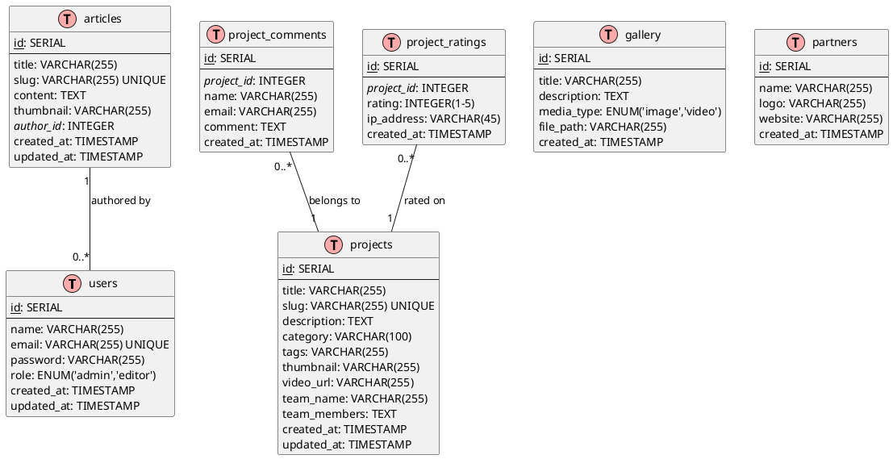

# Entity Relationship Diagram (ERD) - Lab MMT



---

# ERD Diagram (Crow's Foot Notation)

```
┌─────────────────────────┐
│        users            │
├─────────────────────────┤
│ PK  id                  │
│     name                │
│     email (UNIQUE)      │
│     password            │
│     role                │
│     created_at          │
│     updated_at          │
└─────────────────────────┘
            │
            │ 1
            │
            ╿ authors
            │
            │ *
┌─────────────────────────┐
│       articles          │
├─────────────────────────┤
│ PK  id                  │
│     title               │
│     slug (UNIQUE)       │
│     content             │
│     thumbnail           │
│ FK  author_id           │
│     created_at          │
│     updated_at          │
└─────────────────────────┘


┌─────────────────────────┐
│       projects          │
├─────────────────────────┤
│ PK  id                  │
│     title               │
│     slug (UNIQUE)       │
│     description         │
│     category            │
│     tags                │
│     thumbnail           │
│     video_url           │
│     team_name           │◄──── NEW
│     team_members        │◄──── NEW
│     created_at          │
│     updated_at          │
└─────────────────────────┘
            │
            │ 1
            │
            ├──────────────────┬──────────────────┐
            │                  │                  │
            ╿ has             ╿ has             │
            │                  │                  │
            │ *                │ *                │
┌──────────────────┐  ┌──────────────────┐       │
│project_comments  │  │project_ratings   │       │
├──────────────────┤  ├──────────────────┤       │
│ PK  id           │  │ PK  id           │       │
│ FK  project_id   │  │ FK  project_id   │       │
│     name         │  │     rating       │       │
│     email        │  │     ip_address   │       │
│     comment      │  │     created_at   │       │
│     created_at   │  └──────────────────┘       │
└──────────────────┘                              │


┌─────────────────────────┐       ┌─────────────────────────┐
│        gallery          │       │       partners          │
├─────────────────────────┤       ├─────────────────────────┤
│ PK  id                  │       │ PK  id                  │
│     title               │       │     name                │
│     description         │       │     logo                │
│     media_type          │       │     website             │
│     file_path           │       │     created_at          │
│     created_at          │       └─────────────────────────┘
└─────────────────────────┘
```

## Penjelasan Relasi

### 1. users ─── articles (One-to-Many)
- Satu user dapat menulis banyak artikel
- Setiap artikel ditulis oleh satu user (author)

### 2. projects ─── project_comments (One-to-Many)
- Satu proyek dapat memiliki banyak komentar
- Setiap komentar terkait dengan satu proyek

### 3. projects ─── project_ratings (One-to-Many)
- Satu proyek dapat memiliki banyak rating
- Setiap rating terkait dengan satu proyek
- IP address digunakan untuk mencegah rating ganda

### Tabel Independen
- **gallery**: Media galeri (foto/video) - standalone
- **partners**: Data mitra/kolaborasi - standalone

## Constraints & Indexes

### Primary Keys
- Semua tabel: `id` (SERIAL/AUTO_INCREMENT)

### Unique Constraints
- `users.email`
- `projects.slug`
- `articles.slug`

### Foreign Keys
- `articles.author_id` → `users.id` (ON DELETE CASCADE)
- `project_comments.project_id` → `projects.id` (ON DELETE CASCADE)
- `project_ratings.project_id` → `projects.id` (ON DELETE CASCADE)

### Indexes (Recommended)
- `projects(category)` - untuk filtering
- `projects(created_at)` - untuk sorting
- `articles(author_id)` - untuk author lookup
- `project_comments(project_id)` - untuk comment lookup
- `project_ratings(project_id)` - untuk rating calculation

