# Flowchart - Lab MMT Workflow

## 1. User Authentication Flow

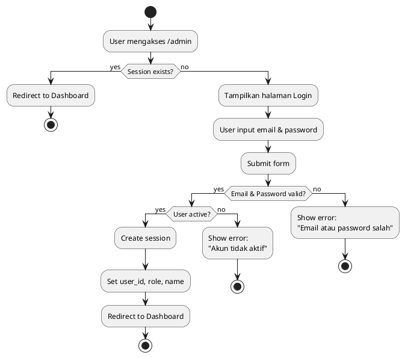

---

## 2. View Projects (Public) Flow

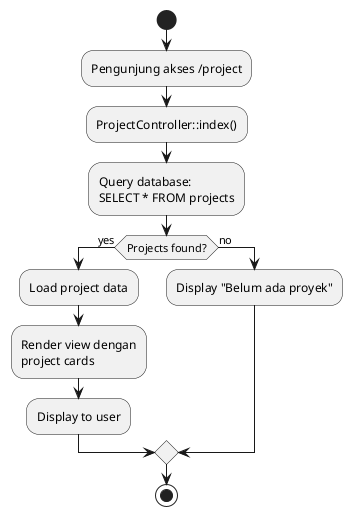

---

## 3. View Project Detail Flow

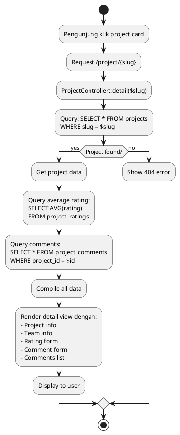

---

## 4. Create Project (Admin/Editor) Flow

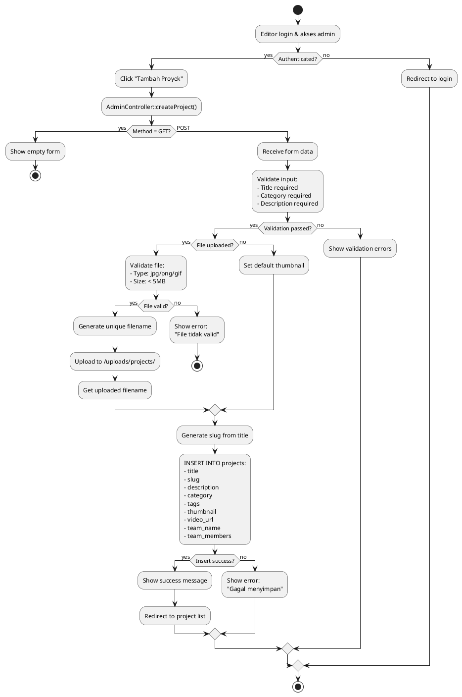

---

## 5. Edit Project Flow

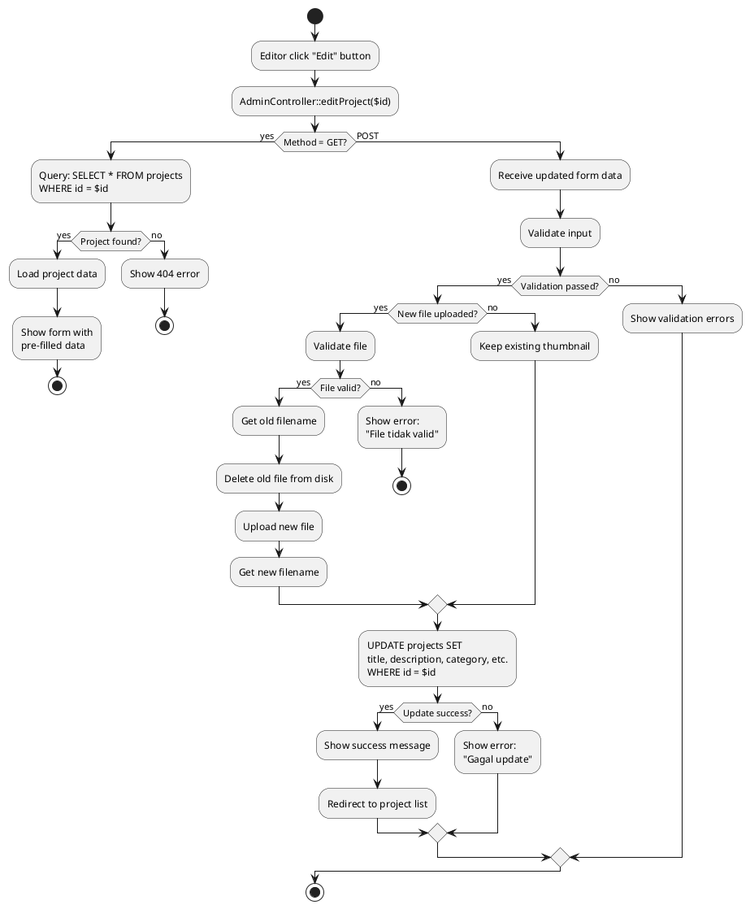

---

## 6. Delete Project Flow

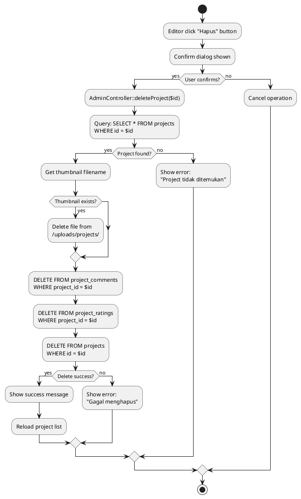

---

## 7. Submit Rating Flow

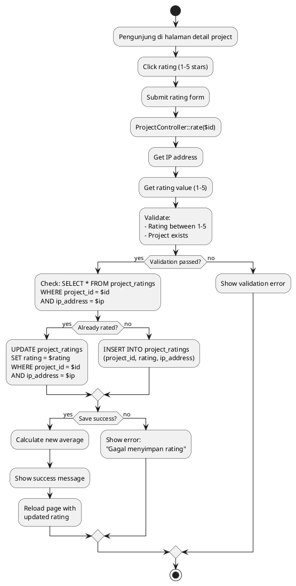

---

## 8. Submit Comment Flow

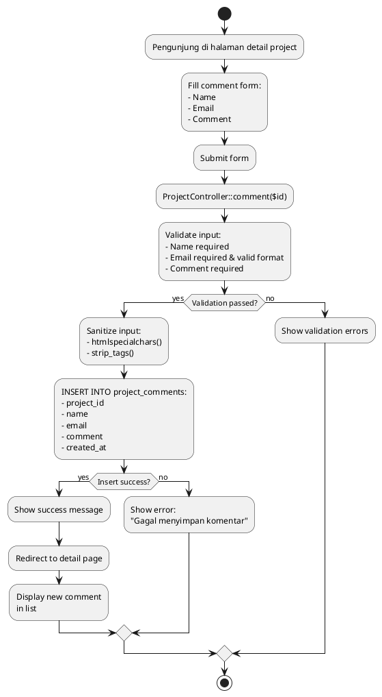

---

## 9. Search/Filter Projects Flow

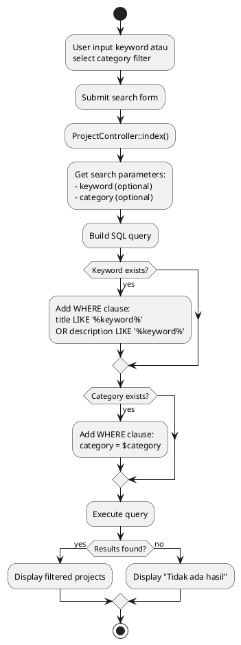

---

## 10. Upload Gallery Media Flow

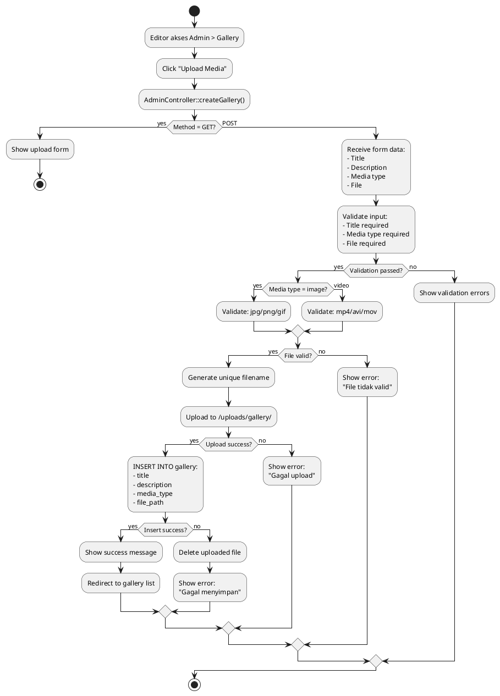

---

## 11. Admin Dashboard Load Flow

```plantuml
@startuml
start
:Admin login;
:Redirect to /admin/dashboard;
:AdminController::index();

if (Authenticated?) then (yes)
  :Query statistics:
  
  SELECT COUNT(*) FROM projects;
  :Get total_projects;
  
  SELECT COUNT(*) FROM articles;
  :Get total_articles;
  
  SELECT COUNT(*) FROM gallery;
  :Get total_gallery;
  
  SELECT COUNT(*) FROM partners;
  :Get total_partners;
  
  :Query recent projects:
  SELECT * FROM projects
  ORDER BY created_at DESC
  LIMIT 5;
  
  :Query recent articles:
  SELECT * FROM articles
  ORDER BY created_at DESC
  LIMIT 5;
  
  :Compile dashboard data;
  :Render dashboard view:
  - 4 statistic cards
  - Recent projects table
  - Recent articles table
  - Quick action buttons;
  
  :Display to admin;
else (no)
  :Redirect to login;
endif

stop
@enduml
```

---

## 12. User Management (CRUD) Flow

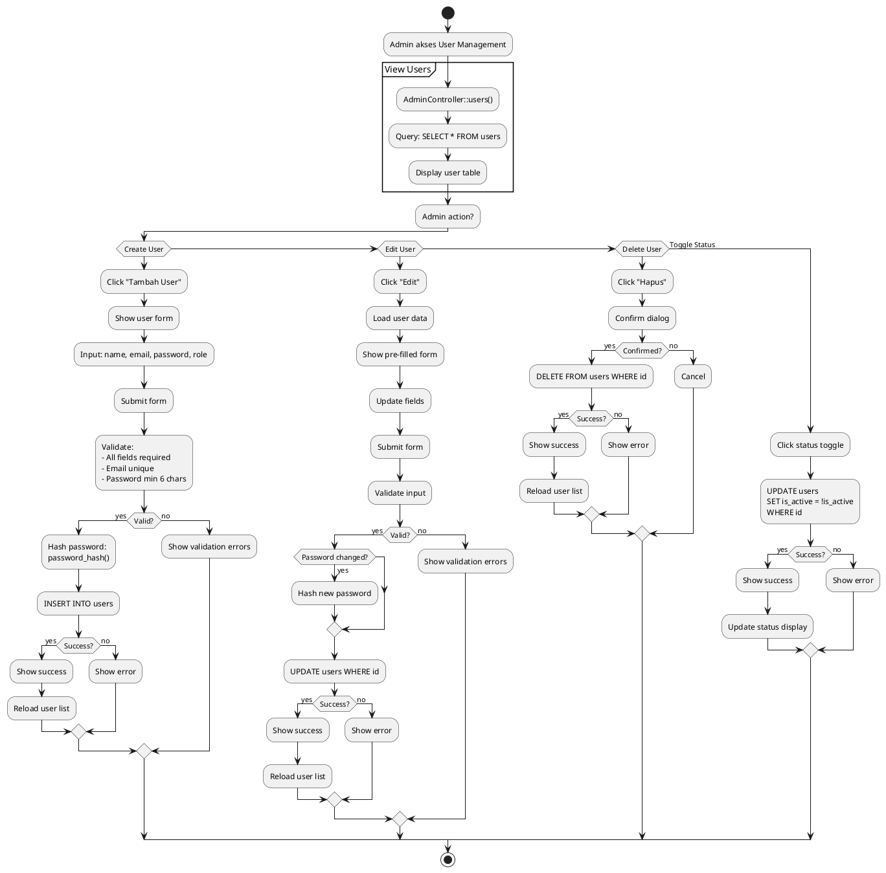

---

## 13. Article Management Flow

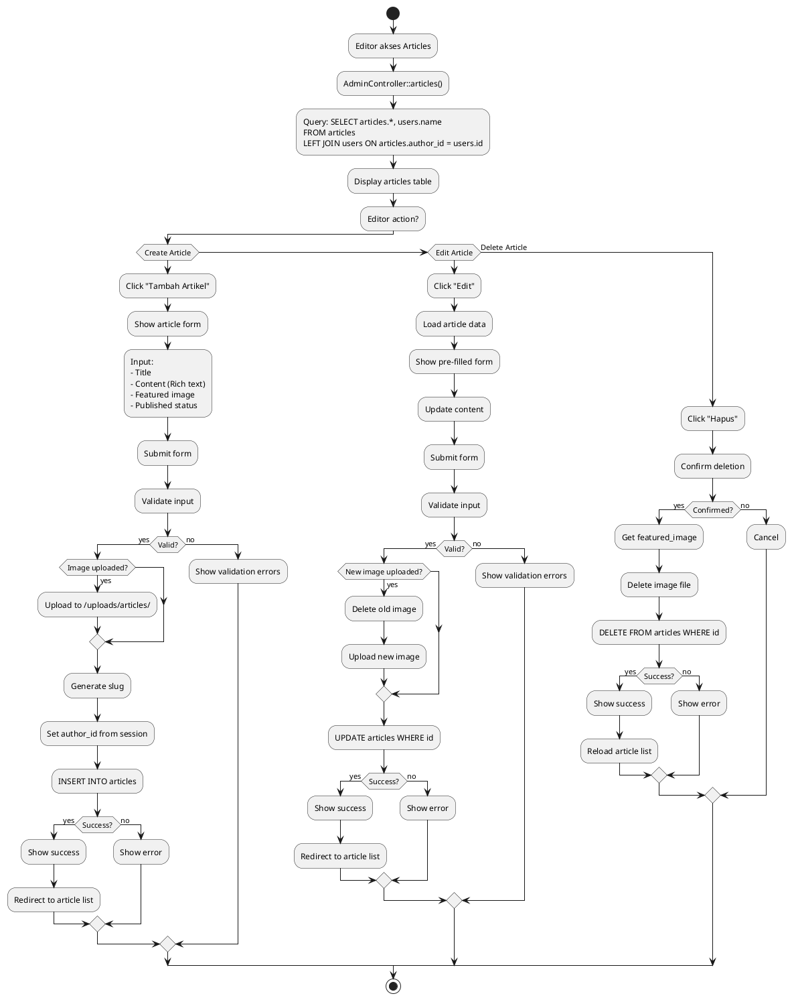

---

## 14. File Upload Process Flow

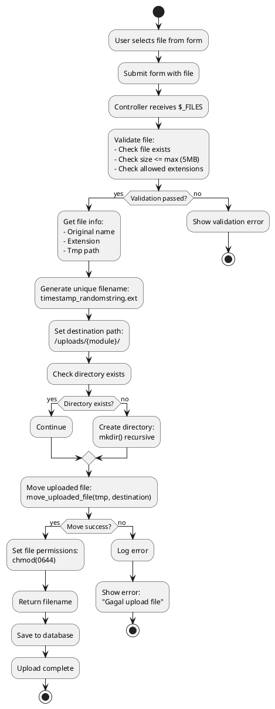

---

## 15. Logout Flow

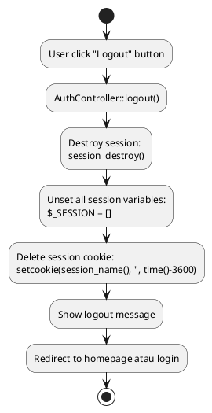

---

## 16. Homepage Load Flow

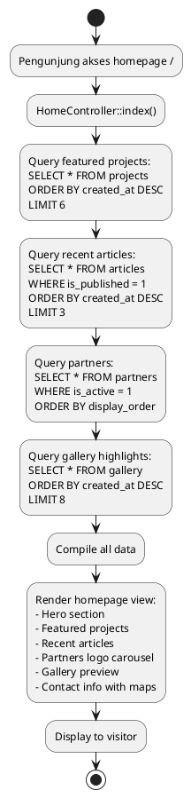

---

## 17. Error Handling Flow

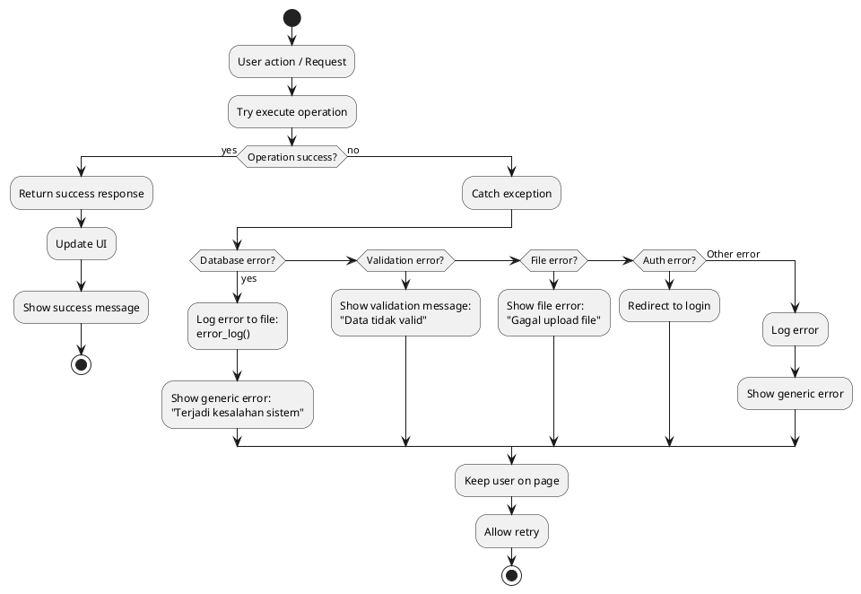

---

## 18. Middleware/Authorization Check Flow

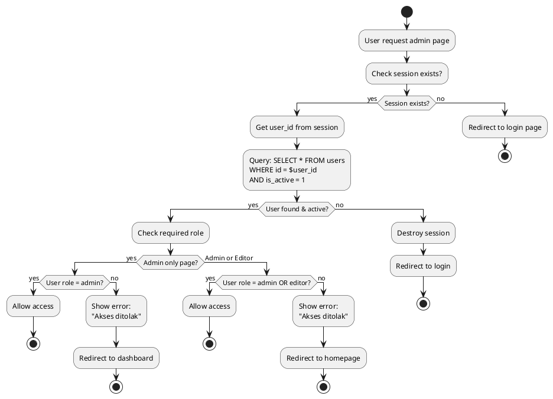

---

## 19. Comment Moderation Flow

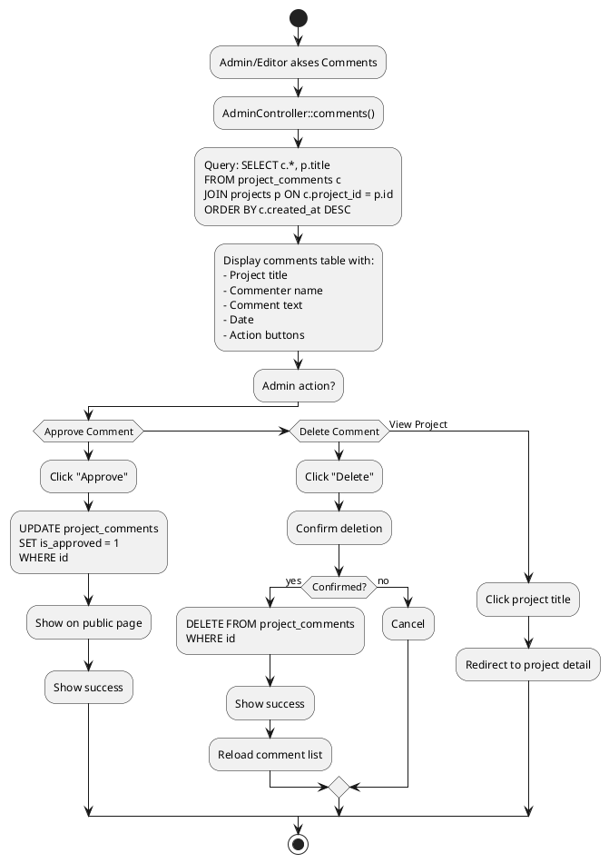

---

## 20. Application Initialization Flow

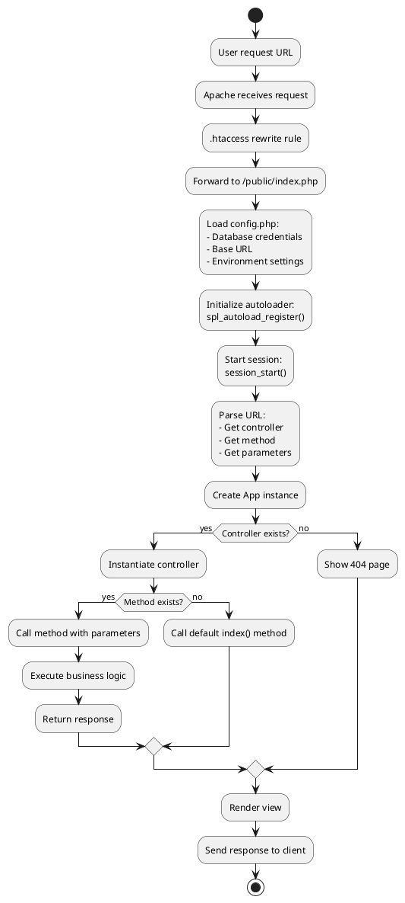

---

**Document**: Workflow Flowcharts  
**Project**: Lab MMT Website  
**Version**: 1.0  
**Date**: 4 Desember 2025  
**Author**: Tim Pengembang Lab MMT

