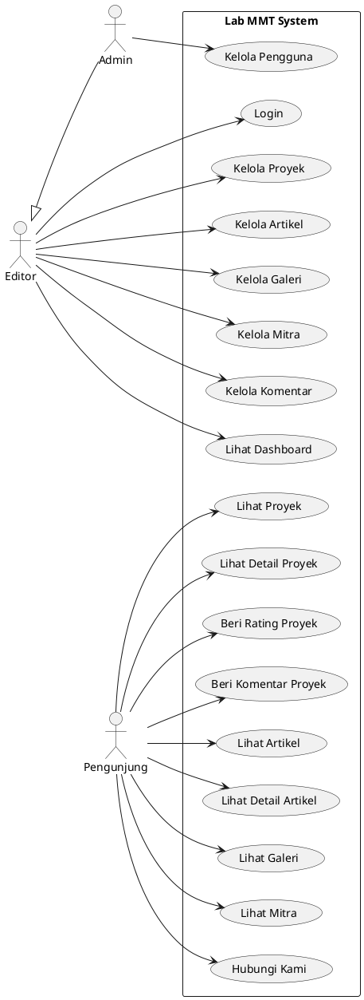

# Use Case Diagram - Lab MMT

## Deskripsi Use Cases

### Pengunjung (Public User)
1. **UC1 - Lihat Proyek**: Melihat daftar semua proyek
2. **UC2 - Lihat Detail Proyek**: Melihat detail lengkap proyek termasuk tim dan anggota
3. **UC3 - Beri Rating Proyek**: Memberikan rating 1-5 untuk proyek
4. **UC4 - Beri Komentar Proyek**: Memberikan komentar pada proyek
5. **UC5 - Lihat Artikel**: Melihat daftar artikel dan berita
6. **UC6 - Lihat Detail Artikel**: Membaca artikel lengkap
7. **UC7 - Lihat Galeri**: Melihat galeri foto dan video
8. **UC8 - Lihat Mitra**: Melihat daftar mitra dan kolaborasi
9. **UC9 - Hubungi Kami**: Mengakses halaman kontak dan maps

### Editor
10. **UC10 - Login**: Login ke sistem admin
11. **UC11 - Kelola Proyek**: CRUD proyek (Create, Read, Update, Delete)
12. **UC12 - Kelola Artikel**: CRUD artikel
13. **UC13 - Kelola Galeri**: CRUD media galeri
14. **UC14 - Kelola Mitra**: CRUD data mitra
15. **UC15 - Kelola Komentar**: Moderasi komentar proyek
16. **UC17 - Lihat Dashboard**: Melihat statistik dan overview

### Admin (extends Editor)
17. **UC16 - Kelola Pengguna**: CRUD pengguna (Admin dan Editor)

